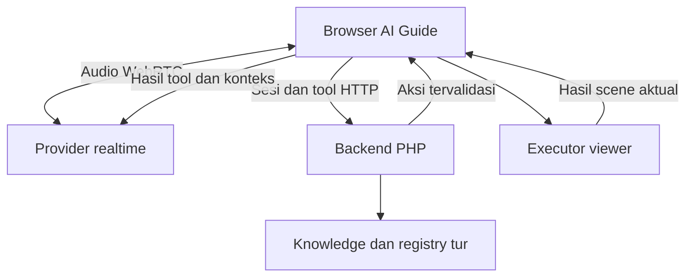

# Rencana Implementasi Mode Percakapan Suara AI Guide

Versi: 2.0 — revisi lengkap, 9 September 2026  
Produk: AI Guide Studio dan runtime AI Guide hasil export  
Status: rancangan implementasi; belum merupakan hasil audit source atau pengujian runtime langsung

## 1. Tujuan dan keputusan utama

Bangun dua cara berinteraksi dengan AI Guide: **Teks** dan **Suara**. Pada mode suara, pengunjung memulai satu sesi, kemudian dapat berbicara berulang kali tanpa menekan tombol kirim untuk setiap ujaran. AI dapat merespons dengan audio, menerima interupsi, memahami pertanyaan lanjutan, serta menjalankan navigasi panorama melalui fungsi aplikasi yang tervalidasi.

Pengalaman yang dituju adalah percakapan dengan pemandu: jawaban ringkas, jeda wajar, konteks lokasi selalu diperbarui, dan tindakan mengikuti maksud pengunjung. Kelancaran percakapan tidak boleh mengurangi ketepatan fakta atau tujuan navigasi.

| Keputusan | Rancangan versi pertama |
|---|---|
| Jalur suara | Speech-to-speech realtime dengan tool aplikasi |
| Kandidat pilot utama | OpenAI Realtime melalui WebRTC |
| Pembanding | Gemini Live melalui WebSocket langsung; prototipe terbatas dengan skenario identik |
| Provider produksi | Pilih satu setelah evaluasi; jangan membangun perpindahan provider otomatis dahulu |
| Backend | PHP dengan permintaan HTTP pendek untuk sesi, knowledge, validasi, dan hasil aksi |
| Media | Audio mengalir langsung antara browser dan provider |
| Data tur | Gunakan knowledge, resolver, serta scene registry yang sudah ada |
| Navigasi | Gunakan executor existing dengan validasi, deduplikasi, dan penanganan pembatalan |
| Pengalaman teks | Tetap tersedia; berbagi konteks aplikasi dengan mode suara |
| Lingkup awal | Satu tur Balai Kota Semarang sebagai pilot, kemudian validasi dua tur sebelum perluasan |
| Distribusi | Perubahan pada runtime master, integrasi Studio, kemudian build/export |

OpenAI mendokumentasikan koneksi WebRTC dari browser, pembukaan sesi melalui backend maupun token sementara, dan penggunaan media track. Pilihan PHP adalah penerapan arsitektur terhadap pola HTTP tersebut, bukan klaim bahwa contoh resmi memakai PHP. [Dokumentasi WebRTC](https://developers.openai.com/api/docs/guides/realtime-webrtc)

Dokumentasi GPT-6 Astra yang diperiksa mencantumkan audio tidak didukung. Karena itu, nama Astra tidak digunakan sebagai pilihan model voice. Model reasoning dapat menjadi tool tambahan untuk kasus kompleks pada tahap berikutnya apabila ada kebutuhan terukur. [Dokumentasi GPT-6 Astra](https://developers.openai.com/api/docs/models/gpt-6-astra)

## 2. Batas audit dan status bukti

Bahan yang tersedia adalah dokumen rencana awal dan dua screenshot runtime AI Guide Balai Kota. Source AI Studio, runtime master, ZIP export, dan deployment aktif belum diperiksa langsung dalam revisi ini.

Gunakan penandaan berikut dalam pekerjaan lanjutan:

- **Teramati:** terlihat pada screenshot atau teks lampiran.
- **Dilaporkan:** temuan kode dari dokumen awal; wajib diverifikasi ulang pada source.
- **Terverifikasi dokumentasi:** kemampuan provider yang didukung halaman resmi yang sudah dibaca.
- **Usulan:** keputusan desain, nilai awal, dan target uji dalam dokumen ini.
- **Belum diuji:** performa, biaya aktual, akses model pada akun, serta perilaku deployment pengguna.

| Temuan dari dokumen awal | Dampak | Tindakan saat audit source |
|---|---|---|
| `package/govirtual-ai/frontend/guide.js:1789` menggunakan Web Speech API dan jeda 2.500 ms | Mikrofon existing merupakan dikte | Pastikan lifecycle-nya bisa dihentikan ketika mode suara dimulai |
| `guide.js:1504` membacakan panel; `guide.js:1607` menambah deskripsi navigasi | Audio berpotensi panjang dan bertumpuk | Pisahkan pembacaan panel dari sesi realtime |
| `api/tts.php:29` menjalankan Python dengan path Windows | Ketergantungan tidak portabel untuk hosting PHP biasa | Jangan jadikan endpoint tersebut prasyarat realtime |
| `guide.js:1648` menggabungkan jawaban kurasi, jaringan, UI, dan aksi | Risiko duplikasi alur ketika menambah voice | Ekstrak titik integrasi minimum untuk konteks, resolver, renderer, dan executor |
| `guide.js:564` sudah memeriksa scene dan mengeksekusi navigasi | Fondasi aksi dapat digunakan ulang | Temukan callback/event sukses, gagal, dan perubahan manual |
| `api/tour-chat.php:50` memiliki resolver deterministik dan retrieval | Tool voice bisa memakai sumber sama | Pisahkan pencarian fakta dari panggilan model teks yang tidak diperlukan |
| Batas backend 240 karakter, input UI 500 | Input dapat ditolak atau dipotong tidak konsisten | Selaraskan kontrak teks; buat batas voice eksplisit tanpa pemotongan diam-diam |
| CORS chat terbuka | Tidak cukup melindungi penerbit sesi berbayar | Audit autentikasi sesi, origin, metode HTTP, dan pembatas penggunaan |
| `index.php:771` menyalin master dan menulis kredensial | Build perlu memahami konfigurasi voice | Telusuri sumber master, penanganan rahasia, serta izin distribusi ZIP |
| `index.php:801` melewati konfigurasi/data saat sinkronisasi | Sync runtime tidak menjamin voice terkonfigurasi | Tambahkan migrasi konfigurasi dengan pelestarian data per tur |

Path dan nomor baris di atas berasal dari laporan lama, bukan lokasi source yang sudah dikonfirmasi. Catat hash/versi master dan export saat audit agar kesimpulan tidak memakai paket yang berbeda.

### Audit UI dari screenshot

1. Tombol mikrofon berada di kolom teks: masuk akal sebagai dikte, tetapi belum menjelaskan adanya sesi ngobrol.
2. Label “Suara: Aktif” dapat membingungkan antara pembacaan jawaban dan mikrofon yang mendengarkan.
3. Panel informasi kanan cukup dominan; pada mode suara perlu dipadatkan agar panorama tetap menjadi fokus.
4. Overlay blur layar penuh cocok sebagai pembuka, bukan tampilan percakapan yang sedang menavigasi.
5. Penanda lokasi kiri merupakan fondasi konteks yang berguna dan perlu tetap tersedia pada mode suara.

## 3. Lingkup produk dan prioritas

| Prioritas | Fitur | Kriteria utama |
|---|---|---|
| P0 | Mulai/akhiri percakapan | Mikrofon hanya aktif selama sesi yang dimulai pengguna |
| P0 | Audio dua arah | Pengunjung dapat berbicara ulang tanpa tombol kirim |
| P0 | Akhir ujaran dan interupsi | AI memberi ruang berpikir dan berhenti ketika disela |
| P0 | Knowledge bersumber | Fakta lokasi memakai data tur yang disetujui |
| P0 | Navigasi | Tujuan valid, aksi tidak ganda, dan status tiba sesuai scene aktual |
| P0 | Klarifikasi dan koreksi | Menangani beberapa tujuan, negasi, dan perubahan maksud |
| P0 | Konteks scene | Berubah ketika navigasi AI maupun perpindahan manual terjadi |
| P0 | Fallback teks | Pengguna dapat melanjutkan ketika voice gagal |
| P0 | Konfigurasi/export | Paket dapat berjalan tanpa Studio yang sedang aktif |
| P0 | Pengendalian penggunaan | Kredensial aman dan batas penggunaan diuji sesuai kemampuan host/provider |
| P1 | Riwayat teks/suara lebih lengkap | Ringkasan, kartu sumber, dan transkrip opsional |
| P1 | Pengucapan lokal dan bahasa | Evaluasi nama tempat; pergantian bahasa sesuai kemampuan model terpilih |
| P1 | Pratinjau admin dan metrik | Admin dapat memeriksa tool, latensi, sumber, dan error |
| P2 | Fokus objek/arah pandang | Hanya setelah registry objek dan adapter viewer siap |
| P2 | Tur terpandu proaktif | Hanya setelah pengguna memilih mode tur terpandu |

Versi pertama tidak mencakup wake word, voice cloning, avatar lip-sync, rekaman audio permanen, navigasi fisik berbasis GPS, atau multi-provider otomatis. Kebutuhan ini dapat dievaluasi setelah pilot.

## 4. Spesifikasi pengalaman pengguna

### Masuk mode suara

1. Pengunjung membuka AI Guide dan memilih “Mulai ngobrol”.
2. Tampilkan informasi singkat bahwa mikrofon digunakan dan audio diproses provider AI.
3. Minta izin mikrofon melalui tindakan pengguna. Jika ditolak, tampilkan petunjuk dan pilihan teks.
4. Buka sesi berbayar setelah izin perangkat berhasil dan konfigurasi dasar valid.
5. Tampilkan “Menghubungkan”, lalu “Mendengarkan” setelah koneksi benar-benar siap.
6. Sapaan awal maksimum satu kalimat. Jangan menyapa ulang setiap scene berubah atau saat reconnect.

### Kontrol yang terlihat selama sesi

| Kontrol | Perilaku |
|---|---|
| Mute mikrofon | Menghentikan pengiriman suara pengguna; status mute eksplisit |
| Hentikan jawaban | Menghentikan jawaban AI saat ini tanpa mengakhiri sesi |
| Akhiri percakapan | Membatalkan pekerjaan, menghentikan media, menutup koneksi, dan menutup sesi aplikasi |
| Lihat percakapan | Membuka transkrip/riwayat tanpa menutupi panorama secara permanen |
| Beralih ke teks | Menutup media voice dan mempertahankan konteks relevan |

Mute bukan janji bahwa sesi provider berhenti ditagih. Ketika mute berlangsung lama, jalankan kebijakan idle dan tawarkan lanjutkan atau akhiri.

### Bahasa dan gaya jawaban

- Bahasa awal Indonesia, ramah dan langsung.
- Default jawaban satu sampai tiga kalimat; jelaskan lebih panjang ketika diminta.
- Maksimum satu pertanyaan klarifikasi pada satu giliran.
- Jangan membacakan URL, JSON, daftar sumber, atau seluruh kartu detail.
- Angka, waktu, dan nama lokal dilafalkan dengan jelas; daftar pengucapan menjadi petunjuk model, bukan jaminan fonetik.
- Hindari sapaan, permintaan izin, atau pertanyaan “ada lagi?” yang berulang.
- Jangan mengumumkan “saya sedang mencari” untuk setiap lookup cepat. Untuk operasi yang terasa lama, beri satu penjelasan singkat tanpa fakta spekulatif.
- Jawaban navigasi dapat singkat: “Baik, saya arahkan ke lobi.” Klaim keberhasilan menunggu hasil perpindahan.

## 5. Model state: koneksi, audio, dan aksi

Jangan memakai satu status tunggal yang membuat “berbicara” dan “mendengarkan” saling meniadakan. Saat AI berbicara, mikrofon perlu tetap mendengarkan agar interupsi bekerja.

| Kelompok | State yang diusulkan |
|---|---|
| Koneksi | `idle`, `requesting_permission`, `connecting`, `connected`, `reconnecting`, `ending`, `ended`, `error` |
| Mikrofon | `inactive`, `active`, `muted`, `unavailable` |
| Giliran pengguna | `waiting`, `speaking`, `committed` |
| Respons AI | `idle`, `resolving`, `speaking`, `interrupted` |
| Aksi panorama | `none`, `pending`, `executing`, `succeeded`, `failed`, `cancelled` |

UI menerjemahkan kombinasi state menjadi label sederhana. Detail state hanya ditampilkan di panel debug admin.

### Aturan siklus hidup

- Hanya satu sesi voice dan satu stream mikrofon aktif per instance AI Guide.
- Cegah klik mulai berulang menciptakan beberapa sesi provider.
- Saat provider gagal setelah mikrofon terbuka, hentikan track dan pulihkan UI.
- Saat tab masuk latar belakang, jeda pengiriman mikrofon dan batalkan aksi tertunda. Terapkan batas idle; ketika kembali, tampilkan tombol lanjutkan bila audio/koneksi membutuhkan tindakan pengguna.
- `pagehide` dapat mencoba cleanup, tetapi callback browser tidak dianggap jaminan penutupan server.
- Jika reconnect dilakukan, maksimum dua percobaan otomatis dalam jendela awal 10 detik. Nilai ini adalah usulan yang dituning saat pilot.
- Reconnect tidak boleh mengulangi tool navigasi terakhir. Bangun ulang konteks dari state aplikasi.
- Akhiri sesi menghentikan track, playback, timer, event listener, data channel, dan peer connection, termasuk ketika backend penutupan tidak merespons.

## 6. Deteksi akhir ujaran dan interupsi

### Deteksi akhir ujaran

Gunakan deteksi giliran provider dan uji dengan bahasa Indonesia. Pada OpenAI, `semantic_vad` mempertimbangkan kemungkinan ujaran sudah selesai, sedangkan `server_vad` menggunakan periode diam. Mulai evaluasi semantic VAD dengan `eagerness: auto`, lalu bandingkan dengan server VAD. [Dokumentasi VAD](https://developers.openai.com/api/docs/guides/realtime-vad)

Rangkaian yang wajib diuji:

- “Saya mau ke… sebentar… toilet.”
- “Bisa jelaskan gedung itu, yang sebelah… kanan?”
- “Ke toilet… eh, ke lobi saja.”
- “Hmm… bukan yang tadi.”
- Ucapan cepat, pelan, berbisik, dan jeda napas.

Jangan menjalankan navigasi dari transkrip parsial atau potongan argumen fungsi yang belum selesai. Ujaran harus sudah dikomit dan permintaan tool harus lengkap serta tervalidasi. Uji batas waktu hening tanpa sekadar memperpendek timer 2.500 ms existing.

Jika sistem terlalu sering memotong pengguna, turunkan agresivitas. Jika lambat merespons, ukur apakah sumbernya deteksi giliran, model, tool, atau playback sebelum mengubah parameter.

### Interupsi audio

OpenAI mendokumentasikan penghentian respons dengan VAD serta pemotongan audio yang belum terdengar pada koneksi WebRTC. Pada jalur WebSocket, pengelolaan playback dan pemotongan membutuhkan penanganan klien. Gunakan perilaku sesuai transport, jangan menerapkan logika WebSocket mentah ke WebRTC tanpa alasan. [Interupsi Realtime](https://developers.openai.com/api/docs/guides/realtime-conversations)

### Interupsi pekerjaan aplikasi

1. Ketika pengguna mulai bicara, tandai generasi respons lama sebagai terinterupsi.
2. Hentikan audio lama sesuai event provider dan perintah aplikasi.
3. Batalkan request HTTP yang masih bisa dibatalkan dengan `AbortController`.
4. Tetap tandai hasilnya usang: pembatalan HTTP tidak menjamin server berhenti bekerja.
5. Aksi yang belum dieksekusi dibuang jika giliran atau versi konteks tidak cocok.
6. Bila perpindahan sudah dimulai dan viewer tidak menyediakan cancel, tunggu hasil aktual; jangan mengirim aksi kedua secara bersamaan.
7. Proses koreksi terbaru dari scene aktual setelah perpindahan pertama selesai/gagal.
8. Tandai riwayat jawaban lama sebagai terinterupsi. Jangan mengarang bagian transkrip persis yang sempat terdengar apabila provider tidak memberikan alignment.

## 7. Arsitektur dan batas kepercayaan



PHP menyimpan kredensial utama, mengikat sesi ke tur/deployment, memvalidasi tool, dan mengambil data resmi. Browser mengelola media dan viewer. Model hanya mengusulkan tool dan menyusun respons dari konteks/hasil tool.

Untuk pilot, browser dapat meneruskan tool call ke PHP. Server tetap memperlakukan argumen sebagai input tak tepercaya: validasi hanya mengizinkan lookup dan perpindahan virtual yang sah. ID tool yang dikirim browser bukan bukti bahwa provider benar-benar mengeluarkan permintaan tersebut.

Arsitektur browser langsung tidak menjamin instruksi model, laporan penggunaan, atau laporan scene dari klien kebal manipulasi. Jangan memakai jalur ini sebagai otorisasi tindakan bisnis sensitif. Jika nantinya diperlukan kontrol tool dan usage yang otoritatif dari provider, evaluasi koneksi kontrol server/sideband atau layanan sesi terkelola. Hal tersebut bisa memerlukan proses server persisten dan harus dinilai terhadap batas shared hosting. [Kontrol server Realtime](https://developers.openai.com/api/docs/guides/realtime-server-controls)

## 8. Pemilihan provider dan API eksternal

| Aspek | OpenAI Realtime | Gemini Live | Keputusan untuk proyek |
|---|---|---|---|
| Percakapan | Speech-to-speech dan fungsi aplikasi | Native audio dan tool | Keduanya kandidat |
| Transport langsung | WebRTC | WebSocket | WebRTC diprioritaskan untuk pilot browser |
| Pekerjaan media browser | Media track dan event channel | Konversi/chunk audio dan antrean playback | Perhitungkan beban maintenance mobile |
| Otorisasi | Negosiasi backend atau token sementara | Token sementara untuk koneksi klien | Kunci permanen tidak masuk JS |
| Interupsi | Dukungan provider, dengan pembatalan aksi oleh aplikasi | Dukungan provider, dengan playback/aksi dikelola aplikasi | Uji audio dan tool secara bersamaan |
| Kesiapan layanan | Verifikasi model terpilih pada akun | Overview yang dibaca berlabel Preview | Catat status model/API ketika pilot |
| Bahasa Indonesia | Belum dibenchmark pada proyek | Belum dibenchmark pada proyek | Penilai lokal memilih berdasarkan hasil |
| Biaya | Belum diukur | Belum diukur | Jangan menyimpulkan lebih murah tanpa data |

Gemini Live mendokumentasikan koneksi WebSocket, input PCM 16-bit 16 kHz dan output PCM 16-bit 24 kHz pada overview yang diperiksa. Jika dipilih, browser membutuhkan pengolahan audio yang sesuai serta pembersihan antrean saat interupsi; token sementara dianjurkan untuk koneksi klien langsung. [Gemini Live](https://ai.google.dev/gemini-api/docs/live-api)

### Jalur integrasi awal OpenAI

- Evaluasi unified WebRTC: browser mengirim SDP ke endpoint PHP, PHP membuka call provider dengan konfigurasi server, lalu mengembalikan SDP jawaban.
- Alternatifnya, PHP membuat client secret sementara melalui `/v1/realtime/client_secrets`; browser menggunakan token tersebut untuk membuka koneksi.
- Negosiasi koneksi menggunakan `/v1/realtime/calls` sesuai dokumentasi yang berlaku.
- Pilih satu jalur setelah memeriksa kebutuhan identitas call, penghentian server, dan hosting. Jangan mengimplementasikan dua jalur autentikasi tanpa kebutuhan.
- Jangan menganggap kedaluwarsa token pembukaan otomatis memutus sesi aktif.

Pola tersebut bersumber dari [panduan WebRTC](https://developers.openai.com/api/docs/guides/realtime-webrtc). Kontrak detail implementasi harus disesuaikan dengan model/API yang benar-benar dapat diakses akun.

### Lembar keputusan provider yang harus diisi

Catat provider, model ID tepat, status stable/preview, suara, bahasa, wilayah/akses akun, versi API, transport, VAD, format audio, batas sesi, resumption, mekanisme penutupan, sumber usage, tarif, retensi, tanggal uji, dan hasil browser. Nilai yang belum diketahui ditulis “belum diverifikasi”, bukan diisi asumsi.

## 9. Modul dan batas perubahan kode

| Modul logis | Tanggung jawab | Integrasi existing |
|---|---|---|
| Voice UI | Kontrol, status, transkrip, aksesibilitas | Shell AI Guide dan panel |
| Voice Session | Mikrofon, WebRTC, playback, event, cleanup | Menonaktifkan dikte/TTS existing saat aktif |
| Conversation Controller | Giliran, interupsi, antrean, timeout | Riwayat percakapan bersama |
| Tour Context Adapter | Scene, objek, pilihan, versi konteks | Event viewer dan state aplikasi |
| Tool Bridge | Validasi bentuk awal, request PHP, korelasi hasil | Resolver dan executor lama |
| Voice Backend | Sesi, izin, konfigurasi, tool, penggunaan | PHP dan konfigurasi server |
| Studio Voice Settings | Pengaturan per tur dan uji admin | Form konfigurasi dan builder |
| Export Validator | Validasi versi, data, kapabilitas | Jalur build dan sync |

Modul logis tidak harus menjadi delapan file atau layanan. Bentuk minimal yang masuk akal adalah satu modul browser voice, satu endpoint PHP dengan operasi terbatas, serta perubahan terarah pada resolver/context/executor/builder. Nama final mengikuti source setelah audit. Jangan melakukan rewrite seluruh `guide.js` hanya untuk merapikan arsitektur.

Gunakan JavaScript yang kompatibel dengan build existing; PHP/cURL untuk HTTP server. Penyimpanan sesi dipilih dari kemampuan host: database existing jika memang tersedia pada deployment; SQLite jika tersedia dan sesuai beban. File JSON hanya untuk pilot terbatas dengan locking dan pembersihan yang benar. Jangan menganggap database Studio ikut tersedia di export.

## 10. Data tur yang perlu dipersiapkan

### Registry scene dan fasilitas

| Field konseptual | Fungsi | Aturan |
|---|---|---|
| `tour_id`, `scene_id` | Identitas | Stabil; server menjadi sumber sah |
| `name`, `aliases` | Nama dan variasi ucapan | Termasuk singkatan yang disetujui |
| `facility_type` | Toilet, lobi, musala, parkir, dan lainnya | Taksonomi konsisten |
| `area`, `floor` | Konteks fasilitas | Hanya isi berdasarkan data |
| `destination_scene_id` | Target navigasi virtual | Harus ada dalam paket |
| `coverage` | `exact`, `nearby`, `information_only`, `unavailable` | Jangan menyamakan scene terdekat dengan berada di dalam fasilitas |
| `object_ids` | Objek terkait | Mengacu registry hotspot/objek |
| `connections` | Relasi scene | Jelaskan apakah edge tur, rute fisik, atau jarak |
| `source_ids`, `verified_at` | Asal data | Bisa ditelusuri admin |

Contoh konseptual: fasilitas bernama “Toilet area lobi”, alias “WC lobi”, mempunyai coverage `nearby` jika panorama hanya menampilkan koridor di dekatnya. AI berkata “Saya arahkan ke area dekat toilet,” bukan “Kita sudah di dalam toilet.” Contoh ini bukan pernyataan bahwa fasilitas tersebut ada pada paket Balai Kota.

### Knowledge dan kebijakan jawaban

- Gunakan konten kurasi yang sudah disetujui sebagai prioritas.
- Hasil lookup berisi fakta, sumber, status ketersediaan, dan objek/scene terkait.
- Data dinamis seperti jam layanan memerlukan tanggal pembaruan; jangan menyajikan data usang sebagai keadaan saat ini.
- Jika informasi lokasi tidak ditemukan, AI menyatakan keterbatasan dan dapat menawarkan topik yang tersedia.
- Pengetahuan umum dapat diaktifkan sebagai kebijakan tur, tetapi harus dibedakan dari fakta lokasi terverifikasi dan tidak boleh menentukan tujuan navigasi.
- Pencarian web langsung tidak menjadi default versi pertama. Bila nanti ditambahkan, hasilnya memerlukan sumber dan batas waktu data.
- Knowledge merupakan data, bukan instruksi eksekusi. Teks di knowledge yang meminta mengabaikan aturan tidak boleh mengubah izin tool.

### Makna “dekat”, “tadi”, dan “di kanan”

“Terdekat” membutuhkan ukuran jarak/rute yang benar; BFS scene hanya menunjukkan sedikitnya perpindahan virtual. “Yang tadi” memakai referensi entitas dan riwayat kunjungan. “Di kanan” membutuhkan arah kamera dan posisi objek yang dipetakan. Tanpa data yang cukup, tanyakan nama atau tunjukkan pilihan; jangan berasumsi model melihat panorama jika gambar tidak dikirim.

## 11. Konteks bersama teks dan suara

Simpan state aplikasi ringan selama sesi pengunjung:

| Data | Kegunaan |
|---|---|
| `session_id`, `tour_id`, `deployment_id` | Isolasi |
| `scene_id`, `scene_revision` | Posisi dan versi konteks |
| `turn_id`, `response_generation` | Membedakan pekerjaan aktif/usang |
| `last_entities`, `last_destination` | Rujukan percakapan |
| `pending_clarification` | Kandidat pilihan yang masih berlaku |
| `visited_scenes` | “Kembali ke tempat tadi” |
| `conversation_summary` | Handoff dan reconnect |
| `recent_messages` | Beberapa giliran relevan |
| `action_ledger` | Deduplikasi dan hasil aksi |

Usulan awal: simpan enam giliran terakhir ditambah ringkasan maksimum 2.000 karakter. Ini anggaran aplikasi, bukan batas provider. Jangan membuat model kedua hanya untuk meringkas setiap giliran; gunakan pembaruan ringkasan terstruktur dan lakukan kompresi hanya bila perlu.

Saat teks → suara, kirim fakta konteks yang diperlukan, pilihan klarifikasi, serta riwayat relevan. Saat suara → teks, tutup media, tandai respons terinterupsi, dan pertahankan konteks. Transkrip input adalah representasi bantu, bukan salinan sempurna pemahaman audio. Jangan menjalankan ulang intent teks dari transkrip voice yang sama.

Pergantian scene manual menaikkan `scene_revision` dan membatalkan navigasi tertunda yang bergantung pada scene lama. Kandidat klarifikasi disegarkan bila perpindahan mengubah relevansinya. Batasi event perubahan arah kamera; jangan mengirim update untuk setiap frame.

## 12. Kontrak API aplikasi

Contoh nama operasi berikut adalah kontrak usulan, bukan endpoint yang sudah ada. Seluruh operasi menggunakan HTTPS dan metode POST, kecuali halaman pemeriksaan kesehatan nonrahasia jika diperlukan.

| Operasi | Masukan inti | Keluaran | Validasi penting |
|---|---|---|---|
| `start_session` | Deployment, tur, scene awal, bahasa, bukti sesi anonim; SDP bila unified | ID sesi, data negosiasi/token, kapabilitas, batas aplikasi | Tur aktif, scene sah, origin, kuota, sesi paralel |
| `update_context` | Sesi, revisi baru, scene/objek | Konteks yang dinormalisasi | Identitas scene dari registry; urutan revisi |
| `execute_tool` | Sesi, call ID, turn ID, revisi, nama tool, argumen | Fakta, klarifikasi, atau aksi berizin | Allowlist, skema, batas payload, isolasi, duplikasi |
| `report_action_result` | Action ID, hasil, scene aktual, revisi | Status aksi dan konteks terbaru | Aksi milik sesi; transisi valid; laporan klien tidak dianggap telemetry provider |
| `end_session` | Sesi dan alasan | Hasil penutupan aplikasi/provider secara terpisah | Idempoten; tidak membuka ulang sesi |

Usulan batas awal: body JSON 16 KiB; query tool maksimum 2.000 karakter; maksimum dua lookup per giliran dan satu aksi navigasi aktif. SDP menggunakan batas terpisah berdasarkan payload nyata pada pilot. Saat batas tercapai, tolak dengan error yang jelas dan minta pertanyaan dipersingkat; jangan potong instruksi navigasi diam-diam.

Respons error konsisten:

```json
{
  "ok": false,
  "error": {
    "code": "STALE_CONTEXT",
    "message": "Lokasi sudah berubah. Tujuan perlu diperiksa kembali.",
    "retryable": false
  },
  "request_id": "example-request-id"
}
```

| Kode | Arti dan respons UI |
|---|---|
| `VOICE_DISABLED` | Tawarkan teks |
| `SESSION_EXPIRED` | Tawarkan mulai sesi baru dengan konteks ringkas |
| `QUOTA_EXCEEDED` | Jelaskan voice tidak tersedia sementara; teks mengikuti kebijakan kuotanya sendiri |
| `RATE_LIMITED` | Retry terbatas sesuai waktu server; hindari retry loop |
| `INVALID_ARGUMENT` | Tidak mengeksekusi aksi |
| `STALE_CONTEXT` | Segarkan konteks, jangan mengulang navigasi otomatis |
| `TOOL_TIMEOUT` | Nyatakan belum berhasil memperoleh informasi/tujuan |
| `NAVIGATION_FAILED` | Tetap pada scene aktual dan tawarkan coba lagi |
| `PROVIDER_UNAVAILABLE` | Tutup media yang tidak diperlukan dan tampilkan fallback |

## 13. Kontrak tool dan navigasi

### Tool A — `lookup_tour_information`

Argumen model: `query`, opsional `entity_id`. Tour ID dan otorisasi berasal dari sesi server. Scene yang dikirim browser diverifikasi keberadaannya.

Hasil: `status` berupa `found`, `partial`, atau `not_found`; `facts`, `source_ids`, `related_entities`, serta catatan batas data. Kartu visual boleh berisi detail lebih lengkap. Model menyusun respons lisan langsung dari fakta, tanpa wajib memanggil model teks existing untuk menulis jawaban kedua.

### Tool B — `resolve_navigation`

Argumen model: `destination_query`, opsional pilihan klarifikasi yang masih berlaku. Server menyelesaikan alias, kategori, coverage, serta kandidat yang sah.

| Status | Isi | Perilaku |
|---|---|---|
| `ready` | Satu tujuan dan aksi berizin | Jalankan melalui executor |
| `clarify` | Dua atau beberapa kandidat terbatas dan ID pilihan | Tanyakan satu klarifikasi |
| `unavailable` | Alasan dan alternatif sah bila ada | Jangan pindah ke scene sembarang |
| `already_there` | Tujuan sesuai scene aktual | Jelaskan tanpa memindahkan ulang |

Contoh hasil `ready`, seluruh ID hanya ilustrasi:

```json
{
  "status": "ready",
  "action": {
    "action_id": "example-action-17",
    "type": "navigate_scene",
    "destination_scene_id": "example-lobby",
    "expected_scene_revision": 12,
    "turn_id": "example-turn-9",
    "coverage": "exact"
  },
  "display": { "destination_label": "Lobi" }
}
```

Sebelum eksekusi, browser memeriksa sesi aktif, turn ID, revisi, action ID, serta allowlist tipe aksi. Parameter navigasi tidak boleh berupa JavaScript, selector bebas, atau URL eksternal sembarang.

### Deduplikasi dan race condition

- Identitas pemrosesan: gabungan session ID dan call ID; simpan hash argumen serta hasil.
- Call ID sama dengan argumen sama mengembalikan hasil sebelumnya. Call ID sama dengan argumen berbeda ditolak.
- Action ID hanya dapat mulai sekali. Aksi selesai tidak diulang karena retry HTTP/reconnect.
- Ledger backend diperbarui atomik; jangan mengandalkan variabel JS saja untuk deduplikasi request.
- Browser melakukan pemeriksaan terakhir tepat sebelum executor dipanggil; pemeriksaan PHP saja tidak cukup mengatasi interupsi yang terjadi sesudah respons server.
- Satu navigasi aktif; koreksi terbaru menggantikan aksi pending. Jika aksi sudah berjalan, gunakan hasil aktual sebelum mengeksekusi koreksi.
- Timeout navigasi mengikuti kemampuan viewer; usulan pilot 10 detik. Verifikasi keberhasilan dari callback scene loaded/scene changed, bukan timer semata.
- Tidak menjanjikan jaminan exactly-once absolut pada sistem terdistribusi. Sasaran aplikasi adalah idempotensi dan pencegahan aksi berulang dalam lifecycle sesi yang diuji.

## 14. UI Studio dan konfigurasi

Tambahkan bagian “Percakapan Suara” pada pengaturan AI per tur. Penempatannya mengikuti navigasi Studio setelah source/UI admin diperiksa.

| Kelompok | Field |
|---|---|
| Aktivasi | Voice aktif, mode awal, tombol yang ditampilkan |
| Provider | Provider, model yang didukung, suara, koneksi kredensial server |
| Percakapan | Bahasa awal, gaya ringkas, sapaan, kebijakan interupsi, pilihan VAD |
| Pengetahuan | Kebijakan fakta tur, pengetahuan umum, konten yang disetujui |
| Navigasi | Navigasi otomatis untuk tujuan tunggal; tool yang diizinkan |
| Penggunaan | Durasi target, idle timeout, sesi paralel, kuota per deployment |
| Privasi | Informasi pemrosesan audio, kebijakan transkrip/retensi aplikasi |
| Deployment | Domain, endpoint relatif/konfigurasi lokasi backend, versi skema |

Jangan tampilkan field model/voice bebas tanpa validasi kapabilitas. Model chat biasa tidak boleh lolos sebagai model realtime hanya karena API key valid. Pengaturan pergantian suara dapat memerlukan sesi baru; UI harus mengikuti kemampuan provider terpilih.

### Fasilitas uji admin

Sediakan tiga pemeriksaan: koneksi provider, uji ngobrol, dan uji navigasi. Tampilkan scene aktif, tool/argumen yang sudah disanitasi, sumber fakta, status aksi, durasi lookup, latensi audio, serta error. Rahasia dan token sementara tidak ditampilkan dalam log.

Preview Studio harus memakai runtime dan konfigurasi efektif yang sama dengan export. Jangan menciptakan implementasi voice khusus preview yang berbeda perilaku dari paket publik.

## 15. UI runtime dan aksesibilitas

### Layar pembuka

Pertahankan identitas lokasi dan contoh pertanyaan. Tambahkan dua pilihan eksplisit “Tanya lewat teks” dan “Mulai ngobrol”. Mikrofon di input teks tetap diberi label dikte jika fitur itu dipertahankan.

### Saat ngobrol

- Panorama tetap terlihat dan dapat digunakan.
- Panel kanan menjadi kartu ringkasan yang dapat diperluas.
- Kontrol sesi ringkas berada pada area yang mudah dijangkau; jangan menutup hotspot utama.
- Label TTS existing menjadi “Bacakan jawaban” agar berbeda dari status “Mendengarkan”.
- Waveform mengikuti sinyal mikrofon nyata; indikator pemrosesan terpisah dari level audio.
- Lokasi aktif tetap terbaca. Pada HP, gunakan panel bawah yang dapat diciutkan.
- Tampilkan target navigasi selama perpindahan dan hasil aktual setelah selesai.
- Fokus keyboard, label tombol, kontras, status screen reader, dan dukungan reduced motion diperiksa.
- Akhiri sesi dengan tombol terlihat; jangan hanya mengandalkan perintah suara.

Detail kartu bersumber tidak harus identik kata demi kata dengan transkrip, tetapi maknanya tidak boleh bertentangan. Bedakan “Transkrip percakapan” dari “Informasi lengkap”.

## 16. Audio browser, perangkat, dan fallback

- Gunakan akses mikrofon melalui aksi pengguna dan HTTPS.
- Minta echo cancellation/noise suppression jika didukung; hasilnya tetap diuji di speaker HP dan headset.
- Matikan speech recognition dikte dan TTS panel ketika realtime aktif.
- Simpan keadaan musik latar sebelum voice; redupkan/jeda sepanjang sesi dan pulihkan hanya jika sebelumnya diputar pengguna.
- Jangan memulai ulang musik yang sebelumnya sudah dimatikan pengguna.
- Uji izin mikrofon/autoplay dan kebijakan iframe pada domain yang benar-benar dipakai.
- Jika izin ditolak, jangan meminta ulang berulang kali. Berikan langkah singkat dan tombol teks.
- Jika input perangkat berubah/hilang, tampilkan keadaan dan minta lanjutkan setelah perangkat siap.
- Jaringan yang memblokir WebRTC mendapatkan fallback teks. Jangan menambahkan relay sendiri sebelum pilot membuktikan kebutuhan.

## 17. Export, migrasi, dan kompatibilitas

### Alur distribusi

1. Identifikasi satu runtime master yang menjadi sumber export.
2. Catat runtime version, config schema version, knowledge version, dan daftar kapabilitas.
3. Integrasikan perubahan voice pada master dan builder.
4. Build paket pilot ke direktori staging, lalu validasi sebelum mengganti paket aktif.
5. Pastikan aset voice memakai URL relatif/base path yang benar di subfolder hosting.
6. Uji paket pilot tanpa Studio berjalan agar dependensi tersembunyi terdeteksi.
7. Build tur kedua dan pastikan konfigurasi, sesi, serta knowledge tidak tertukar.
8. Simpan paket lama untuk rollback; aktifkan bertahap per tur.

### Aturan konfigurasi

- Konfigurasi publik berisi status fitur dan parameter UI yang aman.
- Rahasia provider berada pada konfigurasi server; jangan tertulis dalam bundle JS, source map, atau manifest publik.
- Paket yang dibagikan ke publik tidak berisi kredensial permanen. Deployment installer/configuration memakai jalur server yang sesuai.
- Konfigurasi tur yang tidak mempunyai skema voice mendapat default nonaktif.
- Migrasi menambah field baru tanpa menghapus knowledge atau menimpa pengaturan tur yang valid.
- Sinkronisasi runtime dan migrasi konfigurasi menjadi operasi berbeda yang sama-sama teruji.
- Jika konfigurasi gagal dimigrasikan, mode teks tetap bisa berjalan dan admin mendapat status penyebabnya.

Rollback mengembalikan runtime dan konfigurasi kompatibel. Perubahan skema sesi harus memiliki strategi kompatibilitas atau pembersihan sesi lama. Jangan memulihkan rahasia ke bundle publik.

## 18. Penggunaan, biaya, keamanan, dan privasi

### Pengamanan minimum sejak pilot

- Kredensial khusus deployment/proyek, disimpan server-side.
- Sesi anonim yang diterbitkan server dan diikat ke satu tur/deployment; pengunjung tidak harus login.
- CORS/origin merupakan lapisan tambahan, bukan autentikasi.
- Jika memakai cookie sesi, terapkan perlindungan CSRF yang sesuai.
- Rate limit per sesi/IP dan pembatasan paralel; IP bukan satu-satunya identitas karena jaringan bersama.
- Kuota dihitung atomik sehingga beberapa permintaan start tidak melampaui slot yang tersedia.
- Validasi skema dan allowlist; log disanitasi.
- Tidak menyimpan audio mentah atau transkrip permanen secara default. Riwayat dalam memori untuk sesi aktif dibedakan dari logging server.

### Tiga jenis batas penggunaan

| Jenis | Contoh | Kekuatan batas |
|---|---|---|
| Batas UX | Idle 60 detik, durasi target 5 menit | Klien kooperatif; bukan hard cap |
| Batas penerbitan | Maksimum sesi baru/bersamaan dan reservasi kuota | Ditegakkan PHP pada request baru |
| Batas sesi aktif/provider | Penutupan call yang terverifikasi atau batas provider yang benar-benar keras | Harus dibuktikan bekerja tanpa bergantung pada browser |

Nilai idle 60 detik, sesi 5 menit, dan concurrency pilot 2 adalah usulan awal untuk pengujian privat; bukan limit provider atau nilai produksi final. Idle dihitung dari aktivitas pengguna/tool yang relevan, bukan sekadar audio terus berjalan.

Endpoint `end_session` hanya membantu bila dipanggil. Jika browser ditutup atau dimodifikasi, server perlu mekanisme mandiri untuk menegakkan batas aktif. Evaluasi API penutupan, call ID, scheduler/cron dengan resolusi yang memadai, atau batas akun yang benar-benar keras. Jangan mengklaim plafon per sesi berdasarkan cron yang terlalu jarang atau budget yang hanya berupa peringatan.

Jika kontrol aktif yang diperlukan tidak bisa diwujudkan pada hosting PHP biasa, pilot tetap privat/terbatas dan rancangan deployment perlu disesuaikan. Jangan memaksakan janji hard cap yang tidak dapat dibuktikan.

### Benchmark biaya

Gunakan sesi pembanding 5 menit: 2 menit pengunjung berbicara, 2 menit AI berbicara, 1 menit jeda, delapan giliran, dua lookup, dan dua navigasi. Ini skenario pengukuran, bukan perkiraan jumlah token atau tarif per menit.

Catat audio masuk/keluar, teks, cache, transkripsi jika ditagih terpisah, tool tambahan, model kedua jika dipanggil, serta reconnect. Jangan mengasumsikan waktu diam gratis atau token antarprovider setara.

Rumus: biaya sesi = jumlah biaya penggunaan tiap modalitas + layanan tambahan. Biaya modalitas dihitung dari unit terukur dan tarif resmi model tepat pada tanggal uji. Jangan menghitung cached token dua kali bila usage sudah memisahkannya.

Laporkan biaya per sesi berhasil, per menit sesi, dan proyeksi 100/1.000 sesi berdasarkan campuran penggunaan yang sama. Usage yang hanya dikirim browser diberi label estimasi operasional; rekonsiliasi dengan sumber provider sebelum dipakai sebagai laporan biaya resmi.

### Privasi provider

Verifikasi retensi audio/transkrip, penggunaan data, layanan berbayar vs gratis, lokasi pemrosesan bila relevan, dan kontrol yang tersedia untuk akun. Dokumen ini belum menetapkan klaim zero retention. Informasi pengguna harus sesuai implementasi sebenarnya, termasuk jika pilot merekam transkrip dengan persetujuan khusus untuk QA.

## 19. Observabilitas dan target kualitas

Log metadata minimum: ID sesi/tur, versi runtime, model, koneksi, jumlah giliran, durasi, error, tool, action ID, status hasil, serta usage yang tersedia. Hindari prompt lengkap, token, audio, dan transkrip di log umum.

| Metrik | Cara ukur | Target awal pilot pada jaringan baik |
|---|---|---|
| Akhir ujaran → audio pertama | Dari akhir ucapan yang ditandai pada uji sampai audio benar-benar terdengar | Percakapan ringan median ≤1,5 detik; p95 ≤3 detik |
| Deteksi interupsi → audio berhenti | Event deteksi sampai playback berhenti | p95 ≤300 ms |
| Awal ucapan interupsi → audio berhenti | Penandaan rekaman uji; termasuk waktu deteksi | Laporkan terpisah agar tidak menyembunyikan keterlambatan VAD |
| Tool request → tool result | Timestamp request dan hasil | Laporkan median/p95 per jenis tool |
| Aksi diterima → awal navigasi | Respons valid sampai executor dimulai | Median ≤300 ms; tidak termasuk waktu unduh panorama |
| Navigasi selesai | Executor mulai sampai scene loaded | Laporkan per perangkat/jaringan |
| Keberhasilan maksud navigasi | Tujuan sesuai maksud atau klarifikasi yang tepat | ≥95% dari skenario yang punya data memadai |
| Aksi terlarang/usang/ganda | Ledger dan scene aktual | Nol pada seluruh skenario wajib |
| Naturalitas Indonesia | Minimal tiga penilai, skala 1–5 | Rata-rata ≥4; catat contoh kegagalan |

Target adalah usulan penerimaan, bukan jaminan provider. Respons bertool dilaporkan terpisah dari percakapan ringan. Jika sampel kecil, tulis ukuran sampel dan jangan menyajikan p95 sebagai statistik stabil.

Untuk perbandingan provider, gunakan 20 skenario identik minimal tiga pengulangan masing-masing pada perangkat inti. Bobot: naturalitas 30%, grounding/aksi 25%, latensi/interupsi 20%, keandalan 15%, biaya 10%. Perlindungan kunci dan isolasi tur adalah syarat wajib, bukan skor yang dapat ditukar dengan suara bagus.

## 20. Matriks pengujian penerimaan

| ID | Skenario | Hasil wajib |
|---|---|---|
| V01 | Mulai dengan izin mikrofon | Satu sesi dan satu stream aktif |
| V02 | Izin ditolak | Tidak retry izin terus-menerus; teks tersedia |
| V03 | Klik mulai dua kali | Tidak membuka dua sesi provider |
| V04 | Pengguna berhenti sebentar untuk berpikir | Tidak terlalu cepat memotong ujaran |
| V05 | Percakapan lima giliran | Tidak perlu tekan kirim; konteks terjaga |
| V06 | Pengguna menyela penjelasan | Audio lama berhenti; respons berikut mengikuti koreksi |
| V07 | Interupsi saat lookup masih berjalan | Hasil usang tidak memicu jawaban/aksi lama |
| V08 | Interupsi tepat sebelum navigasi | Aksi pending dibatalkan |
| V09 | Koreksi saat viewer sedang memuat | Tidak ada dua navigasi bersamaan; gunakan scene aktual |
| V10 | “Saya mau ke toilet” dengan satu kandidat | Navigasi valid tanpa konfirmasi berulang |
| V11 | Beberapa kandidat toilet | Klarifikasi; “yang dekat lobi” memakai pilihan tersimpan |
| V12 | Toilet tidak ada dalam cakupan | Tidak mengarang target |
| V13 | “Saya tidak mau ke toilet” | Tidak navigasi |
| V14 | “Ke toilet… eh ke taman saja” | Maksud akhir digunakan; tidak mengeksekusi transkrip parsial |
| V15 | Fasilitas hanya memiliki scene sekitar | Audio menjelaskan coverage sebenarnya |
| V16 | Klaim “sudah sampai” | Hanya setelah scene cocok dan coverage sesuai |
| V17 | Scene tujuan gagal dimuat | AI menyatakan gagal; konteks tetap aktual |
| V18 | Pengguna pindah scene manual | Context revision berubah; hasil lama diabaikan |
| V19 | Tujuan lintas tur/manipulasi scene ID | Server menolak |
| V20 | Call ID diulang | Tidak ada aksi kedua |
| V21 | Call ID sama, argumen berbeda | Ditolak sebagai konflik |
| V22 | Reconnect setelah navigasi | Tidak mengulang aksi; ringkasan dipulihkan |
| V23 | Teks → suara → teks | Riwayat relevan terjaga; tidak menggandakan intent |
| V24 | Noise dan audio speaker AI | Tidak memicu navigasi liar; evaluasi echo |
| V25 | Nama lokal dan singkatan | Pemahaman/pengucapan dinilai penilai Indonesia |
| V26 | Kuota habis/token invalid/provider gagal | Status jelas, cleanup lengkap, fallback |
| V27 | Mute/akhiri/tab latar belakang | Pengiriman audio mengikuti status; mikrofon mati setelah akhiri |
| V28 | Iframe lintas domain | Izin diuji pada konfigurasi deployment nyata |
| V29 | Knowledge memuat teks instruksi berbahaya | Tidak mengubah izin atau menjalankan aksi di luar allowlist |
| V30 | Build dua tur dan rollback | Tidak bercampur; teks existing tetap berfungsi |

Perangkat inti: Chrome Android, Safari iPhone, dan browser desktop yang digunakan pengguna. Uji speaker dan headset, Wi-Fi baik dan seluler kurang stabil. Catat versi browser/OS serta kondisi jaringan. Android saja tidak mewakili Safari.

Pemeriksaan otomatis difokuskan pada kontrak tool, isolasi tur, deduplikasi, revisi usang, transisi aksi, validasi konfigurasi export, dan cleanup lifecycle yang dapat diuji. Uji manual dipakai untuk kualitas audio, jeda, interupsi nyata, izin perangkat, dan naturalitas. Gunakan framework existing jika ada; jangan menambah framework hanya untuk pemeriksaan sederhana.

## 21. Tahapan, dependensi, dan hasil kerja

Estimasi untuk satu developer yang memahami proyek; Planologi/QA ikut menyiapkan dan menilai data. Angka adalah hari kerja aktif, bukan komitmen kalender. Akses akun, revisi data, serta masalah hosting dapat menambah waktu.

| Tahap | Pekerjaan dan keluaran | Syarat selesai | Estimasi |
|---|---|---|---|
| A — Audit source | Peta master/Studio/export, event viewer, data resolver, versi dan risiko | Jalur integrasi jelas; baseline teks/navigasi tercatat | 1–2 hari |
| B — Pilot sesi aman dan audio | Koneksi provider, izin, interupsi audio, cleanup, batas pilot; uji pembanding terbatas | Audio dua arah bekerja pada HP/desktop; tidak ada kunci publik | 2–4 hari |
| C — Tool dan konteks | Lookup, resolver, klarifikasi, ledger, pembatalan, hasil scene | Skenario navigasi/koreksi wajib lulus | 3–5 hari |
| D — UI percakapan | Dua mode, handoff riwayat, audio tur, fallback, aksesibilitas | Pengguna dapat menyelesaikan alur tanpa instruksi teknis | 2–4 hari |
| E — Studio dan export | Pengaturan, preview admin, migrasi, validator, paket dua tur | Export mandiri, isolasi data, rollback berhasil | 2–4 hari |
| F — QA dan rollout | Matriks perangkat, benchmark kualitas/biaya, perbaikan prioritas | Semua syarat wajib lulus; risiko tersisa terdokumentasi | 3–5 hari |

Total indikatif **13–24 hari kerja**. Tahap C bergantung pada B dan data tur yang memadai. E menggunakan kontrak konfigurasi yang ditentukan sejak A, meski UI lengkap dikerjakan belakangan. Pengamanan API berbayar dimulai di B, bukan menunggu F.

### Pembagian peran

- Developer: implementasi runtime/backend/Studio/export, validasi kontrak, telemetry, dan rollback.
- Planologi/kurator: fasilitas, alias, scene coverage, sumber fakta, serta pengucapan lokal.
- QA: skenario percakapan, perangkat, interupsi, grounding, serta bukti hasil.
- Owner/admin: batas pemakaian, akun provider, domain deployment, dan penerimaan pilot.

### Artefak hasil implementasi yang harus tersedia

1. Catatan audit source dan daftar perubahan per komponen.
2. Runtime master yang diperbarui dan versi konfigurasi.
3. Kontrak API/tool serta contoh error.
4. Dataset pilot yang tervalidasi.
5. Paket export pilot dan paket tur kedua.
6. Laporan uji perangkat, percakapan, navigasi, serta biaya.
7. Panduan konfigurasi deployment dan rollback.

## 22. Peluncuran bertahap dan Definition of Done

Urutan rollout: pilot privat satu tur → evaluasi bersama QA/Planologi → pilot publik terbatas setelah kontrol penggunaan memadai → validasi tur kedua → perluasan per tur melalui feature flag.

Rollback segera jika ada kebocoran kredensial, navigasi lintas tur, aksi usang setelah koreksi, lonjakan pemakaian tak terkendali, atau kegagalan cleanup mikrofon. Kegagalan voice tidak otomatis mematikan mode teks yang masih sehat.

Versi pertama dinyatakan selesai ketika:

- [ ] Sesi voice dapat digunakan beberapa giliran tanpa tombol kirim.
- [ ] Deteksi akhir ujaran dan interupsi lolos uji Indonesia.
- [ ] Tool memakai fakta dan tujuan tur yang sah.
- [ ] Klarifikasi, negasi, koreksi, dan perpindahan manual berfungsi.
- [ ] Hasil navigasi sesuai scene aktual dan coverage.
- [ ] Tidak ada aksi ganda/usang/lintas tur pada pengujian wajib.
- [ ] Mode teks dan voice berbagi konteks tanpa menggandakan tindakan.
- [ ] Mikrofon, audio, koneksi, dan timer dibersihkan setelah sesi.
- [ ] Provider/model yang dipilih tercatat beserta hasil benchmark.
- [ ] Pengendalian sesi baru dan batas sesi aktif dijelaskan serta diuji sesuai klaim.
- [ ] Konfigurasi Studio terbawa ke export tanpa membocorkan rahasia.
- [ ] Dua tur terisolasi, paket lama kompatibel, dan rollback teruji.
- [ ] Latensi, ukuran sampel, kegagalan, dan biaya aktual dilaporkan.
- [ ] Instruksi deployment dan keterbatasan operasional tersedia.

## 23. Pertanyaan teknis yang diselesaikan pada audit awal

Pertanyaan berikut adalah pekerjaan pemeriksaan, bukan alasan menunda penyusunan plan:

1. Di mana runtime master yang benar dan apa hubungannya dengan paket Balai Kota?
2. Viewer menyediakan event apa untuk scene loaded, gagal, dan navigasi manual?
3. Apakah executor mendukung cancel saat scene sedang dimuat?
4. Apakah resolver existing bisa dipanggil tanpa memanggil model teks?
5. Apakah tur punya registry fasilitas/alias atau perlu penambahan data?
6. Penyimpanan sesi dan scheduler apa yang benar-benar tersedia pada hosting export?
7. Apakah domain memasang tur melalui iframe, subfolder, atau lintas origin?
8. Bagaimana API key saat ini disimpan dan dimasukkan ke ZIP?
9. Model voice apa yang dapat diakses akun dan bagaimana penutupan/usage diverifikasi?
10. Apakah ada kebutuhan hard cap per sesi yang mengharuskan kontrol server tambahan?

Jawaban dicatat dalam hasil Tahap A/B. Implementasi mengikuti hasil audit dan mempertahankan kontrak produk di atas.

## 24. Sumber resmi dan batas verifikasi

Dokumentasi berikut telah dibaca dalam percakapan ini; pemeriksaan utama dilakukan 9 September 2026. Fitur aktual tetap diuji pada model, akun, browser, dan deployment yang dipilih.

- [OpenAI Realtime dengan WebRTC](https://developers.openai.com/api/docs/guides/realtime-webrtc) — koneksi browser, negosiasi backend, dan token sementara.
- [OpenAI Voice Activity Detection](https://developers.openai.com/api/docs/guides/realtime-vad) — server VAD dan semantic VAD.
- [OpenAI Realtime Conversations](https://developers.openai.com/api/docs/guides/realtime-conversations) — lifecycle, tool, dan interupsi.
- [OpenAI Server-side Controls](https://developers.openai.com/api/docs/guides/realtime-server-controls) — kontrol server/sideband.
- [GPT-6 Astra](https://developers.openai.com/api/docs/models/gpt-6-astra) — modalitas model.
- [Gemini Live Overview](https://ai.google.dev/gemini-api/docs/live-api) — transport, audio, token sementara, dan status overview.
- [Gemini Live Capabilities](https://ai.google.dev/gemini-api/docs/live-api/capabilities) — kapabilitas dan batas sesi.

Tarif model spesifik, akses akun, efektivitas penghentian sesi pada hosting pengguna, dan ketentuan retensi untuk deployment belum diverifikasi dalam plan ini. Angka biaya tidak dibuat-buat. Seluruh timeout, ambang kualitas, prioritas, kontrak aplikasi, dan estimasi pengerjaan di atas merupakan usulan proyek yang perlu dibuktikan melalui pilot.
